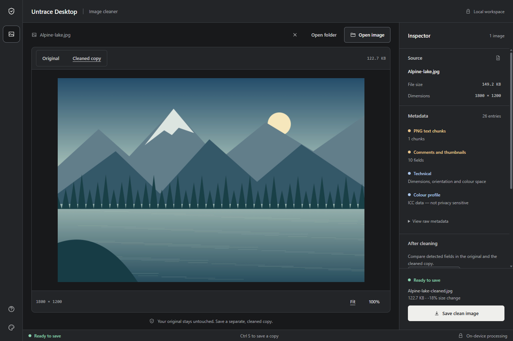
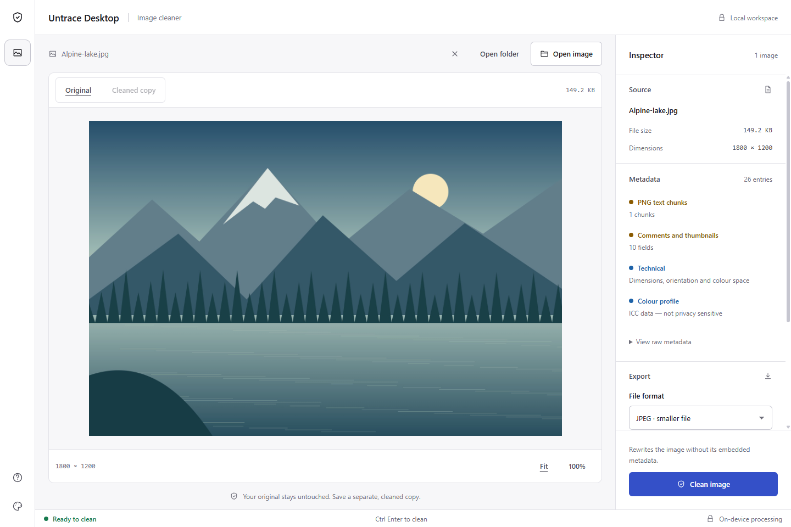
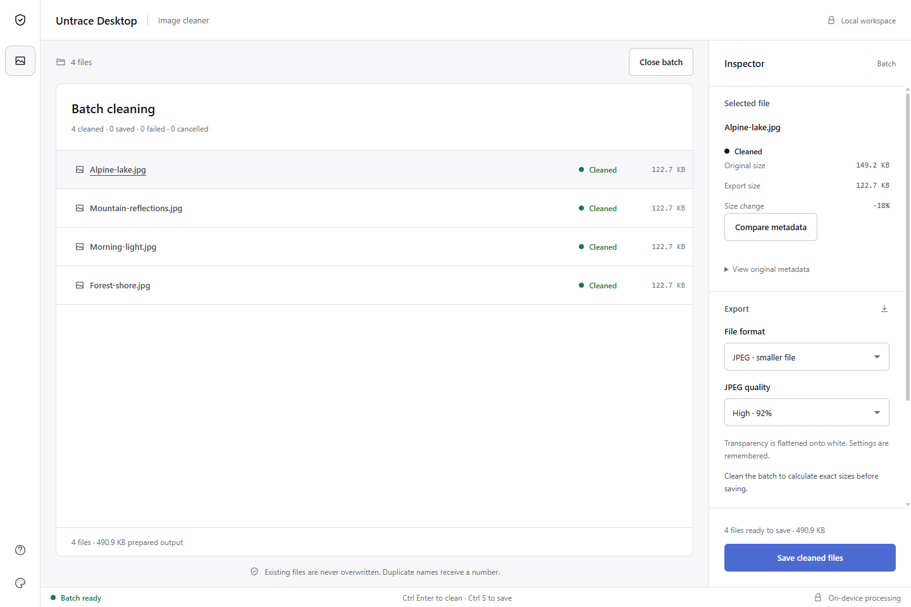

<div align="center">

# Untrace Desktop

**Inspect image metadata. Save a cleaner copy. Keep it local.**

An offline image metadata cleaner for Windows, with batch processing and fourteen themes.

[](LICENSE)
[](#run)
[](CHANGELOG.md)

[Download — GitHub](https://github.com/donishki/Untrace/releases/latest) · [Download — Gitea](https://git.ptbox.org/dasp/Untrace/releases/latest) · [Build and verify](#build-and-verify) · [Changelog](CHANGELOG.md) · [Publishing guide](PUBLISHING.md)

</div>

An offline desktop edition of [developersharif/untrace](https://github.com/developersharif/untrace). Inspect image metadata, rewrite the image, and save a separate copy. This locally built derivative retains the original MIT license and attribution.

## Screenshots

Real screenshots of version 1.7.0 using generated landscape artwork, without personal photos or paths.

### A focused workspace



### Light appearance



### Batch processing



## Run

Download from [GitHub Releases](https://github.com/donishki/Untrace/releases/latest) or [Gitea Releases](https://git.ptbox.org/dasp/Untrace/releases/latest).

| Package | Use |
| --- | --- |
| `Untrace-Desktop-1.7.0-setup-x64.exe` | Install on 64-bit Windows. Recommended for most PCs. |
| `Untrace-Desktop-1.7.0-setup-x86.exe` | Install on 32-bit Windows. Also runs on 64-bit Windows. |
| `Untrace-Desktop-1.7.0-portable-x64.exe` | Run the 64-bit app from a writable folder or USB drive. |
| `Untrace-Desktop-1.7.0-portable-x86.exe` | Run the 32-bit portable app. |

Installers work for your Windows account, offer an installation folder and shortcuts, and can be removed through Windows Settings > Apps. No administrator rights are required. Settings survive upgrades and uninstall. Install one architecture at a time; x64 and x86 installed editions share preferences.

Requires Windows 10 or 11 for x64, or Windows 10 for x86. The x86 edition uses Electron 43.8.3, the last Electron series supporting 32-bit Windows; its support ends in January 2027. The x64 edition uses Electron 44.3.0. No Node.js, browser installation, or internet is required to run either edition. Executables are unsigned; Windows may show an unknown-publisher or SmartScreen prompt. Portable launchers extract the runtime to a temporary folder.

Open or drop an image, review the Inspector, choose an export format, select **Clean image**, and save the separate copy. You can also select several images or a folder for a batch.

The window has an image workspace, a scrolling metadata inspector, export settings, before/after viewing, fit/100% zoom, fourteen themes and Help. The bottom status bar shows progress. There are no promotional sections or external pages required to use the app.

| Shortcut | Action |
| --- | --- |
| Ctrl+O | Open image |
| Ctrl+V | Paste image |
| Ctrl+Enter | Clean image or remaining batch images |
| Ctrl+S | Save the cleaned copy or prepared batch files |
| Esc | Cancel active processing, close a dialog, or close the current image |
| F1 | Open Help |

## Batch cleaning

Select several files with **Open image**, use **Open folder**, or drop images/folders into an empty or single-image workspace. Folders include nested files. The batch queue scans files first, flags GPS data, and reports Ready, Cleaned, Saved, Failed or Cancelled for each file. Select a row for details and metadata comparison. Only supported image files enter the queue; documents, executables and other unsupported files are ignored entirely; failed decoding never produces a claimed clean export.

Choose a format and **Clean batch**, then review the actual output sizes. Use **Choose output folder** and **Save cleaned files** to write the results. Subfolders are combined into the selected destination; duplicate names get numbered suffixes. Existing files and originals are never overwritten by batch saving. A failed save retains its prepared output so it can be retried after selecting a writable folder or freeing disk space.

**Cancel processing** or **Esc** stops scanning/encoding and leaves finished results available. During saving, the current file finishes and the remaining files stop. Use the clean/save buttons to continue unfinished work. Closing the batch or the app discards unsaved results; the queue is not restored across restarts. Close the current batch before opening another selection.

Images are decoded sequentially in background workers. Prepared output blobs are held until saved or discarded, so very large batches can still use substantial memory. Saved batch blobs are released while comparison details remain available.

## Inspection and export size

A prominent **Location data in original** warning shows detected coordinates (or GPS field counts) without contacting a map service. The warning describes the original, even after cleaning.

For one image, **Preview export size** calculates the actual encoded output size using the current format and quality. It does the encoding work once; **Clean image** reuses that prepared output. Changing settings invalidates the preview and any unsaved export. In batch mode, cleaning prepares all output sizes before any files are saved.

**Compare metadata** shows detected fields before and after cleaning, with Not detected afterward, Still present, Changed, Output field or Unverified results. GPS and camera fields appear first. Scanning failures are reported as incomplete; absence of detected metadata is not proof of its absence. Required image headers and a standard colour profile generated by the encoder can appear in the output.

Format and JPEG quality are saved automatically for the next launch and shared between single-image and batch workflows. Output-folder access is requested for each new batch and is not persisted.

## Appearance

Use the palette button at the bottom left to open **Appearance**. Choose Light, Dark, Graphite, Paper, Cobalt or Ember. Graphite uses neutral charcoal and silver; Paper pairs warm white with dark olive ink; Cobalt combines a dark navy frame with a light workspace; Ember pairs carbon black with warm orange. Eight additional editor-inspired palettes are available: One Dark, Dracula, Tokyo Night, Night Owl, GitHub Dark, GitHub Light, Catppuccin Mocha and Catppuccin Latte. The picker groups editor favourites and Untrace originals in a scrolling gallery with live previews and a fixed Done button. See [theme inspirations and credits](THEME-CREDITS.md). **Follow Windows** tracks the operating system's light/dark setting, including changes while the app is open.

Choices are saved automatically and restored before the workspace first appears. Themes affect the interface only, not previews or exported image pixels. Existing light/dark preferences are retained. Earlier custom themes migrate automatically: Midnight to Cobalt, Forest to Graphite, Plum to Ember, and Sand to Paper. The renamed edition still uses the same `Untrace-data` folder so updating does not discard settings. Keep the new EXE alongside that folder.

Untrace Desktop is a derivative of developersharif's Untrace, not an official upstream release. The original project remains credited in Help and the MIT license is retained.

## Export and limitations

- **Automatic:** PNGs below one million pixels remain PNG; other decodable images become JPEG at 92% quality.
- **PNG:** preserve transparency and avoid JPEG compression. Files can be larger.
- **JPEG:** choose 85%, 92% or 100% quality. Transparent areas become white. Even 100% JPEG quality is not lossless.
- Changing export settings invalidates the previous result. Clean again before saving.
- JPEG and PNG work best. AVIF support depends on the decoder. HEIC and TIFF may need conversion to JPEG or PNG first.
- Rewriting removes metadata containers, including EXIF, GPS, XMP and C2PA content credentials. Original colour profiles, animation and additional pages are not preserved; colours can change. The encoder can add a standard sRGB profile, which is shown in metadata comparison.
- If verification detects remaining EXIF/XMP/IPTC metadata, a second pass uses JPEG at 95% quality on white and reports that conversion. Failed decoding is reported as **Not cleaned** and offers no clean download.
- Scanning is heuristic; the raw signature scan covers the first megabyte. No findings are not proof of no metadata. Verification is best effort, not a forensic certificate.
- Removing metadata does not remove visible watermarks or identifying content, guarantee anonymity, or prevent platform AI labels.

## Portable data and privacy

Portable preferences and Chromium session files live in `Untrace-data` beside the launcher. Installed and source-run editions use `%APPDATA%\Untrace Desktop`, separate from portable settings. Keep it with the EXE to retain preferences. Close Untrace Desktop before deleting that folder to reset it. The runtime also uses the Windows temporary folder, so portable does not mean forensic trace-free.

Images are processed locally and originals are not automatically overwritten. The application blocks HTTP/WebSocket requests, denies permission requests, and has no telemetry or updater. The source link in Help opens your default browser when clicked. The renderer is sandboxed, with Node integration disabled and a restrictive content security policy. A narrow preload bridge opens the native output-folder chooser and saves encoded bytes only inside that selected destination, using exclusive file creation. Image scanning and encoding run in terminable background workers.

## Why Electron?

Electron embeds Chromium and Node, which makes this portable build self-contained and gives it a consistent rendering engine. Interface appearance comes from the application design, not a special Electron theme. Electron has a substantial runtime and process-memory overhead; it is not the lightest option for a small utility.

Tauri can reuse this Svelte interface and produce a smaller package by using the system WebView2 runtime on Windows. A self-contained offline package must account for that dependency. Switching wrappers alone does not make image decoding and encoding faster; those operations need separate profiling. Electron is retained for this version's standalone portable requirement.

References: [Electron overview](https://www.electronjs.org/docs/latest/), [Electron performance](https://www.electronjs.org/docs/latest/tutorial/performance), [Tauri webviews](https://tauri.app/reference/webview-versions/).

## Build and verify

Use Node.js 22.13 or newer and npm on Windows x64 / x86. Dependency downloads require internet access.

```powershell
npm ci
npm test
npm run release:windows
node scripts/smoke-portable.mjs x64
node scripts/smoke-portable.mjs x86
```

Installers and portable EXEs are written to `release/x64/` and `release/x86/`. The unpacked apps are in `release/x64/win-unpacked/` and `release/x86/win-ia32-unpacked/`; keep all their files together. `npm run portable` builds both portable launchers; `npm run installer` builds both installers. `npm run desktop` launches from source, and `npm run dev` runs the same workspace in a development browser. Desktop packaging removes remote font imports from generated assets without modifying vendored tokens; system fonts are used offline.

To run the full suite against the packaged application:

```powershell
$env:UNTRACE_TEST_EXE = (Resolve-Path 'release/x64/win-unpacked/Untrace Desktop.exe').Path
npx playwright test
Remove-Item Env:UNTRACE_TEST_EXE
```

Checks cover offline operation, renderer isolation, file acceptance, JPEG white matte, metadata removal, PNG transparency, export invalidation, preview switching, keyboard controls, small-window layout, saving and failure reporting. Additional checks cover real GPS-tagged JPEGs, metadata comparison, exact size previews, saved export preferences, nested-folder batches, duplicate names, worker cancellation/retry, cancelled saves, failed-save retry and output-path validation. Tests save theme screenshots and a local idle process-memory sample to `test-results/`; summed working sets can double-count shared pages and are not a cross-framework benchmark.

The smoke script checks extraction and startup of the single-file launcher. Use the folder build for full Playwright Electron tests because the portable launcher does not forward the child process's debugger output. To regenerate the icon from the source SVG: `npm run build:desktop`, then `node scripts/make-icon.mjs`.

See [CHANGELOG.md](CHANGELOG.md) for dated changes and [LICENSE](LICENSE) for the original license. Electron licenses accompany the runtime.

## Project repositories

Source and releases: [GitHub](https://github.com/donishki/Untrace) and [Gitea](https://git.ptbox.org/dasp/Untrace). The original project is [developersharif/untrace](https://github.com/developersharif/untrace).

## License

Untrace Desktop retains the upstream MIT license, copyright (c) 2025 Sharif. Desktop modifications by Dario P. See [LICENSE](LICENSE) and [THEME-CREDITS.md](THEME-CREDITS.md).
